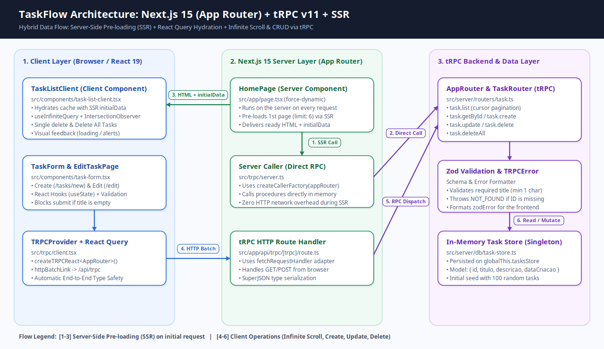
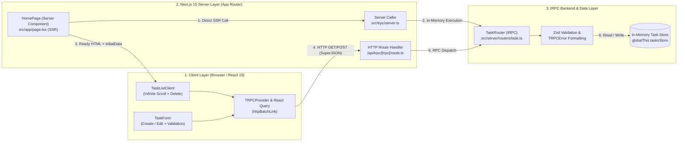

# Architecture Documentation - TaskFlow (Next.js 15 & tRPC)

> **Live Demo (Vercel):** [https://taskflow-trpc-nextjs15.vercel.app](https://taskflow-trpc-nextjs15.vercel.app)  
> **Language / Idioma:** **English** | [Português (ARCHITECTURE.pt-BR.md)](./ARCHITECTURE.pt-BR.md)  
> **Main README:** [English (README.md)](./README.md) | [Português (README.pt-BR.md)](./README.pt-BR.md)

This document explains the architecture of **TaskFlow**, detailing how the **Frontend (React 19 / Next.js 15 App Router)**, **Type-Safe Communication Layer (tRPC v11 + React Query)**, and **In-Memory Backend** interact.

---

## 1. Architecture Overview (Visual Diagram)

### Data Flow Diagram (Mermaid)

---

## 2. Architectural Layers & Key Decisions

The project follows a clean **separation of concerns** inside a Fullstack TypeScript monolithic setup (Next.js 15 App Router):

### 2.1. In-Memory Data Layer (`src/server/db/task-store.ts`)
Because the challenge requires maintaining the task list in memory without an external database, we must account for two behaviors in Next.js:
1. *Hot Module Replacement (HMR)* in development mode reloads modules on file edits.
2. API Route Handlers and Server Components must share the exact same in-memory reference inside the Node.js process.

**Solution:**
* We use a **Singleton attached to `globalThis`** (`globalForTasks.tasksStore`).
* The store automatically seeds **100 randomized tasks** (with staggered creation timestamps) so **SSR** and **Infinite Scroll** can be tested immediately.
* Each task implements the required schema fields:
  * `id`: `string` (unique UUID generated via `crypto.randomUUID()`).
  * `titulo`: `string` (required task title).
  * `descricao`: `string | undefined` (optional task description).
  * `dataCriacao`: `number` (Unix timestamp in milliseconds).

---

### 2.2. tRPC Backend & Validation Layer (`src/server/`)
The backend is built with **tRPC v11** and **Zod**, organized into three files:

1. **`src/server/trpc.ts` (Initialization & Context):**
   * Configures `superjson` as the data transformer so types are serialized cleanly between server and client.
   * Configures a custom `errorFormatter` that catches `ZodError` validation failures and exposes them in a structured format to the frontend.
2. **`src/server/routers/task.ts` (CRUD Procedures):**
   * `task.list`: Accepts `limit` (defaults to `6`) and `cursor` (offset index). Returns the slice of items, `nextCursor` (when more items remain), and `total`.
   * `task.getById`: Looks up a task by `id` and throws `TRPCError({ code: "NOT_FOUND" })` with a clear message if not found.
   * `task.create`: Validates input with Zod (`titulo` required with `trim().min(1)`) and adds the new task to the store.
   * `task.update`: Validates `id`, `titulo`, and `descricao`. Throws `TRPCError({ code: "NOT_FOUND" })` if the target task does not exist.
   * `task.delete`: Removes a task by `id` or throws `NOT_FOUND` if it has already been deleted.
   * `task.deleteAll`: Clears all tasks from memory at once and returns the number of deleted items.
3. **`src/server/root.ts` (AppRouter & Caller Factory):**
   * Combines routers into `appRouter` and exports the `AppRouter` type (imported by the frontend for full *End-to-End Type Safety* and editor autocomplete).
   * Exports `createCaller`, allowing Next.js Server Components to invoke tRPC procedures directly during SSR.

---

### 2.3. Hybrid Communication Bridge (`src/trpc/` & `src/app/api/trpc/`)
The application combines **two ways of calling tRPC** to get the best performance from Next.js 15:

1. **Server-Side Direct Caller (`src/trpc/server.ts`):**
   * Used by *Server Components* during **Server-Side Rendering (SSR)**.
   * Instead of making an unnecessary HTTP request from the server to itself (`localhost:3000/api/trpc`), `getServerTrpc()` calls the tRPC procedure directly in Node.js memory with zero network overhead.
2. **Client-Side HTTP Batch Link (`src/trpc/client.tsx` & `src/app/api/trpc/[trpc]/route.ts`):**
   * When the user interacts with the page in the browser (scrolling down for Infinite Scroll, creating, updating, or deleting a task), React client components use `@trpc/react-query` hooks.
   * Those requests travel over HTTP to `/api/trpc/[trpc]` using `httpBatchLink` (which batches concurrent operations into a single HTTP call).

---

### 2.4. Frontend & User Experience Layer (`src/app/` & `src/components/`)

1. **SSR Pre-loading (`src/app/page.tsx`):**
   * Configured with `export const dynamic = "force-dynamic"` so Next.js dynamically renders the page on the server on every request.
   * Pre-fetches the first batch of tasks on the server and passes it as `initialData` to `<TaskListClient />`.
2. **Hydration, Infinite Scroll & Deletion (`src/components/task-list-client.tsx`):**
   * Hydrates `trpc.task.list.useInfiniteQuery` with `initialData` from SSR so the user sees the initial tasks immediately in the server-rendered HTML without an initial loading spinner.
   * An `IntersectionObserver` watches the bottom sentinel element: whenever the user scrolls near the end of the list, `fetchNextPage()` automatically fetches the next batch of 6 tasks.
   * Supports both **single task deletion** and **bulk deletion (Delete All Tasks)** with granular loading states (`Deleting...`), automatic React Query cache invalidation, and dismissible success/error alert banners.
3. **Reusable Create & Edit Form (`src/components/task-form.tsx`):**
   * Shared by both `/tasks/new` (`mode="create"`) and `/tasks/[id]/edit` (`mode="edit"`).
   * Manages form state via React Hooks (`useState`) and performs client-side validation (preventing submission if the title is empty or whitespace-only) while also displaying any error messages returned by the backend.
