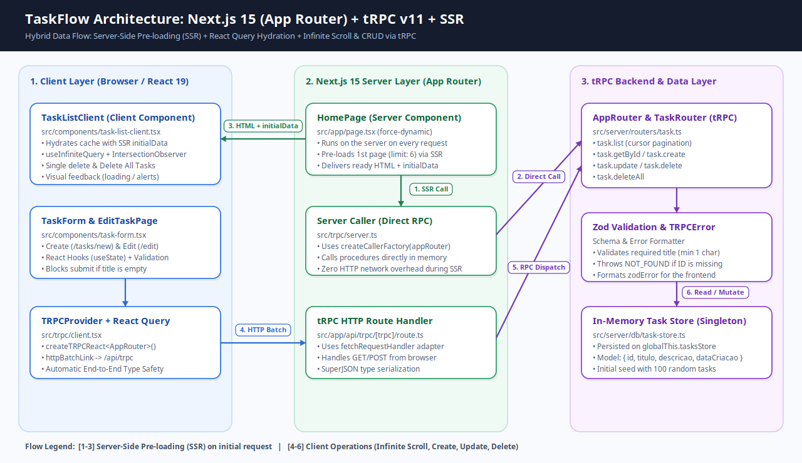
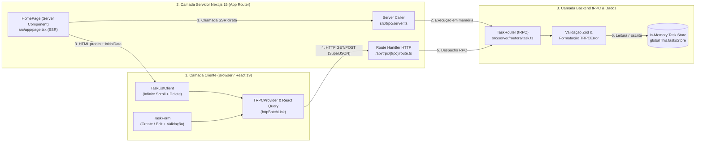

# Documentação de Arquitetura - TaskFlow (Next.js 15 & tRPC)

> **Demo Online (Vercel):** [https://taskflow-trpc-nextjs15.vercel.app](https://taskflow-trpc-nextjs15.vercel.app)  
> **Idioma / Language:** [English (ARCHITECTURE.md)](./ARCHITECTURE.md) | **Português**  
> **README Principal:** [English (README.md)](./README.md) | [Português (README.pt-BR.md)](./README.pt-BR.md)

Este documento descreve em detalhes a arquitetura utilizada na construção do **TaskFlow**, explicando como as camadas de **Frontend (React 19 / Next.js 15 App Router)**, **Comunicação Tipada (tRPC v11 + React Query)** e **Backend em Memória** interagem entre si.

---

## 1. Visão Geral da Arquitetura (Diagrama Demonstrativo)

### Diagrama de Fluxo (Mermaid)

---

## 2. Como a Arquitetura foi Dividida

O projeto foi desenhado seguindo o princípio de **separação clara de responsabilidades** dentro de uma estrutura Fullstack TypeScript monolítica (Next.js App Router):

### 2.1. Camada de Dados em Memória (`src/server/db/task-store.ts`)
Como o desafio solicita manter a lista de tarefas em memória sem banco de dados externo, precisamos lidar com duas particularidades do ambiente Next.js:
1. O *Hot Module Replacement (HMR)* em modo de desenvolvimento recarrega os arquivos a cada alteração.
2. Rotas de API e Server Components precisam enxergar exatamente a mesma instância da lista de tarefas no processo do Node.js.

**Solução adotada:**
* Utilizamos um **Singleton anexado ao `globalThis`** (`globalForTasks.tasksStore`).
* O store inicializa automaticamente **100 tarefas de conteúdo variado** (com timestamps escalonados) para permitir testar imediatamente o **SSR** e o **Infinite Scroll**.
* Cada tarefa segue rigorosamente a modelagem exigida:
  * `id`: `string` (UUID único gerado via `crypto.randomUUID()`).
  * `titulo`: `string` (obrigatório).
  * `descricao`: `string | undefined` (opcional).
  * `dataCriacao`: `number` (timestamp Unix em milissegundos).

---

### 2.2. Camada de Backend e Contratos (`src/server/`)
O backend foi estruturado inteiramente com **tRPC v11** e **Zod**, dividido em três arquivos principais:

1. **`src/server/trpc.ts` (Inicialização e Contexto):**
   * Configura o `superjson` como *transformer*, garantindo que estruturas de dados sejam serializadas sem perda de tipo entre servidor e cliente.
   * Configura um `errorFormatter` customizado que intercepta erros de validação do `ZodError` e os anexa ao payload de erro, facilitando a exibição de mensagens amigáveis no frontend.
2. **`src/server/routers/task.ts` (Procedures CRUD):**
   * `task.list`: Recebe `limit` (padrão `6`) e `cursor` (índice de paginação). Retorna os itens daquela página, o `nextCursor` (se houver mais páginas) e o `total` de tarefas.
   * `task.getById`: Busca uma tarefa pelo `id` e lança `TRPCError({ code: "NOT_FOUND" })` com mensagem explicativa caso não exista.
   * `task.create`: Valida via Zod (`titulo` obrigatório com `trim().min(1)`) e insere no store.
   * `task.update`: Valida `id`, `titulo` e `descricao`. Caso o `id` não seja encontrado no store, lança `TRPCError({ code: "NOT_FOUND" })`.
   * `task.delete`: Remove uma tarefa específica pelo `id` ou lança `NOT_FOUND` caso ela já tenha sido excluída.
   * `task.deleteAll`: Limpa todas as tarefas da memória de uma só vez e retorna a contagem de itens removidos.
3. **`src/server/root.ts` (AppRouter e Caller Factory):**
   * Unifica as rotas no `appRouter` e exporta o tipo `AppRouter` (que é importado pelo frontend para fornecer *End-to-End Type Safety* e autocomplete).
   * Exporta o `createCaller`, que permite que o servidor Next.js execute as funções do tRPC diretamente no SSR.

---

### 2.3. Ponte de Comunicação Híbrida (`src/trpc/` e `src/app/api/trpc/`)
O projeto combina **duas formas de consumo do tRPC** para extrair o melhor do Next.js 15:

1. **Consumo no Servidor via Direct Caller (`src/trpc/server.ts`):**
   * Usado pelos *Server Components* durante o **Server-Side Rendering (SSR)**.
   * Em vez de fazer uma requisição HTTP de rede do servidor para ele mesmo (`localhost:3000/api/trpc`), o `getServerTrpc()` invoca a procedure do tRPC diretamente na memória do Node.js. Isso reduz a latência do SSR a quase zero.
2. **Consumo no Cliente via HTTP Batch Link (`src/trpc/client.tsx` e `src/app/api/trpc/[trpc]/route.ts`):**
   * Quando o usuário interage com a página no navegador (rolando a tela no Infinite Scroll, criando, editando ou excluindo uma tarefa), o cliente React usa os hooks do `@trpc/react-query`.
   * Essas chamadas trafegam via HTTP para o Route Handler `/api/trpc/[trpc]` usando `httpBatchLink` (que agrupa chamadas simultâneas em uma única requisição HTTP).

---

### 2.4. Camada de Frontend e Experiência do Usuário (`src/app/` e `src/components/`)

1. **Pré-carregamento com SSR (`src/app/page.tsx`):**
   * Configurado com `export const dynamic = "force-dynamic"` para garantir que o Next.js renderize a página dinamicamente no servidor a cada acesso.
   * Busca o primeiro lote de tarefas no servidor e passa o resultado como `initialData` para o componente cliente `<TaskListClient />`.
2. **Hidratação, Infinite Scroll e Exclusão (`src/components/task-list-client.tsx`):**
   * Recebe o `initialData` vindo do SSR e hidrata o `trpc.task.list.useInfiniteQuery`. Assim, o usuário vê as primeiras tarefas instantaneamente no HTML inicial (sem tela em branco ou *loading spinner* na primeira carga).
   * Um `IntersectionObserver` monitora o final da lista: sempre que o usuário rola a página até o elemento sentinela, `fetchNextPage()` é disparado automaticamente, buscando o próximo lote de 6 tarefas.
   * Possui botões para **excluir uma tarefa individual** ou **excluir todas as tarefas**, com estados de carregamento (`Deleting...`), invalidação automática do cache do React Query e banners visuais de sucesso ou erro.
3. **Formulário Unificado de Criação e Edição (`src/components/task-form.tsx`):**
   * Reutilizado tanto pela rota `/tasks/new` (`mode="create"`) quanto pela rota `/tasks/[id]/edit` (`mode="edit"`).
   * Gerencia o estado dos campos com React Hooks (`useState`) e faz validação no cliente antes de enviar (bloqueando o envio caso o título esteja vazio ou apenas com espaços em branco), além de exibir qualquer erro retornado pelo backend.
