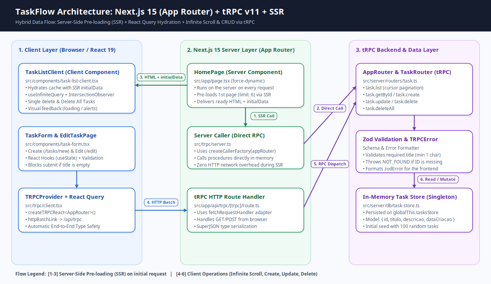

# TaskFlow - Task Management System (Next.js 15 & tRPC)

> **Live Demo (Vercel):** [https://taskflow-trpc-nextjs15.vercel.app](https://taskflow-trpc-nextjs15.vercel.app)  
> **GitHub Repository:** [https://github.com/muferro/taskflow](https://github.com/muferro/taskflow)  
> **Language / Idioma:** **English** | [Português (README.pt-BR.md)](./README.pt-BR.md)  
> **Architecture Docs:** [English (ARCHITECTURE.md)](./ARCHITECTURE.md) | [Português (ARCHITECTURE.pt-BR.md)](./ARCHITECTURE.pt-BR.md)  
> **Part 1 (Theoretical Questions):** [`answers.md`](./answers.md)

A clean and functional task management web application (CRUD) built with **Next.js 15 (App Router)**, **React 19**, **TypeScript**, **Tailwind CSS**, and **tRPC v11**. It stores tasks in memory on the server and combines **Server-Side Rendering (SSR)** with **Infinite Scroll**.

---

## System Architecture



The application uses a **hybrid Fullstack TypeScript architecture** powered by Next.js 15:
1. **On Initial Page Load (SSR):** The Server Component (`src/app/page.tsx`) calls a direct tRPC *Server Caller* (`src/trpc/server.ts`), reading the first page of tasks directly from the in-memory `taskStore` without HTTP network overhead and sending the pre-rendered HTML to the browser.
2. **On Client Interactions (CSR / Infinite Scroll / CRUD):** Client Components hydrate the React Query cache with the SSR data and perform paginated queries (`useInfiniteQuery` + `IntersectionObserver`) and mutations (`create`, `update`, `delete`, `deleteAll`) over the `/api/trpc/[trpc]` HTTP endpoint.

For an in-depth technical breakdown, check [`ARCHITECTURE.md`](./ARCHITECTURE.md) (or [`ARCHITECTURE.pt-BR.md`](./ARCHITECTURE.pt-BR.md) in Portuguese).

---

## Implemented Features

1. **tRPC Backend & In-Memory Store:**
   - **Task Model (`src/server/db/task-store.ts`):**
     - `id`: Auto-generated unique identifier (`UUID`).
     - `titulo`: Required title string (validated with Zod on the backend and on the client form).
     - `descricao`: Optional description string.
     - `dataCriacao`: Unix timestamp (in milliseconds) generated automatically on creation.
     - Pre-seeded with **100 random tasks** to immediately demonstrate SSR and Infinite Scroll.
   - **CRUD Operations (`src/server/routers/task.ts`):**
     - `task.list`: Returns tasks sorted from newest to oldest with cursor-based pagination (`limit` and `cursor`) for Infinite Scroll.
     - `task.getById`: Fetches a single task by `id` for the edit page (throws a `NOT_FOUND` error if missing).
     - `task.create`: Creates a new task after validating that the title is not empty.
     - `task.update`: Updates the title and description of an existing task (throws a clear `NOT_FOUND` error if the ID does not exist).
     - `task.delete`: Deletes a task by `id` (throws `NOT_FOUND` if the task does not exist).
     - `task.deleteAll`: Deletes all tasks from memory at once.

2. **Next.js 15 Frontend (App Router):**
   - **Task List with SSR (`src/app/page.tsx`):** The initial batch of tasks is pre-loaded on the server using tRPC's `createCaller` before delivering the HTML (`dynamic = "force-dynamic"`).
   - **Infinite Scroll (`src/components/task-list-client.tsx`):** Uses tRPC/React Query's `useInfiniteQuery` paired with `IntersectionObserver` to incrementally load more tasks as the user scrolls down.
   - **Direct Deletion & Bulk Deletion with Visual Feedback:** Users can delete individual tasks or delete all tasks directly from the list view, with loading indicators (`Deleting...`) and success/error alert banners.
   - **Create & Edit Task Form (`src/app/tasks/new/page.tsx` & `src/app/tasks/[id]/edit/page.tsx`):** Controlled functional component using React Hooks (`useState`), client-side validation (blocking empty titles), and clear error handling for backend errors.

---

## Project Structure

```text
src/
├── app/
│   ├── api/trpc/[trpc]/route.ts  # Next.js App Router HTTP handler for tRPC
│   ├── tasks/
│   │   ├── new/page.tsx          # Create task page
│   │   └── [id]/edit/page.tsx    # Edit task page
│   ├── layout.tsx                # Root layout with TRPCProvider
│   └── page.tsx                  # Home page with SSR pre-loading
├── components/
│   ├── task-form.tsx             # Reusable form component (Create & Edit)
│   └── task-list-client.tsx      # Task list with Infinite Scroll & direct deletion
├── server/
│   ├── db/task-store.ts          # In-memory store (persisted on globalThis)
│   ├── routers/task.ts           # tRPC CRUD procedures + Zod validation
│   ├── root.ts                   # Main tRPC AppRouter
│   └── trpc.ts                   # tRPC initialization & context
└── trpc/
    ├── client.tsx                # tRPC client + React Query Provider
    └── server.ts                 # Server-side caller helper for SSR
```

---

## How to Run Locally

### Prerequisites
- **Node.js** (v18.18+ or v20+)
- **npm**

### Steps

1. Install dependencies:
   ```bash
   npm install
   ```

2. Start the development server:
   ```bash
   npm run dev
   ```

3. Open in your browser:
   ```text
   http://localhost:3000
   ```

### Production Build

To verify and run the production build:
```bash
npm run build
npm start
```
