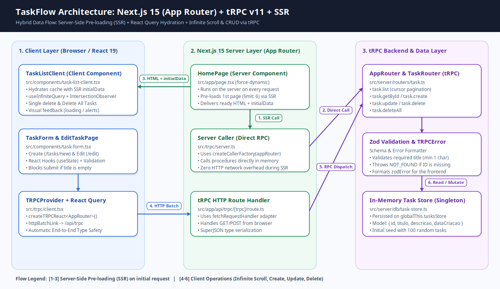

# TaskFlow - Gerenciador de Tarefas (Next.js 15 & tRPC)

> **Demo Online (Vercel):** [https://taskflow-trpc-nextjs15.vercel.app](https://taskflow-trpc-nextjs15.vercel.app)  
> **Repositório GitHub:** [https://github.com/muferro/taskflow](https://github.com/muferro/taskflow)  
> **Idioma / Language:** [English (README.md)](./README.md) | **Português**  
> **Documentação de Arquitetura:** [English (ARCHITECTURE.md)](./ARCHITECTURE.md) | [Português (ARCHITECTURE.pt-BR.md)](./ARCHITECTURE.pt-BR.md)  
> **Parte 1 (Respostas Teóricas):** [`answers.md`](./answers.md)

Aplicação web simples e funcional para gerenciamento de tarefas (CRUD), construída com **Next.js 15 (App Router)**, **React 19**, **TypeScript**, **Tailwind CSS** e **tRPC v11**, mantendo os dados em memória no servidor e utilizando **Server-Side Rendering (SSR)** com **Infinite Scroll**.

---

## Arquitetura do Sistema



A aplicação utiliza uma arquitetura **Fullstack TypeScript híbrida** no Next.js 15:
1. **Na carga inicial da página (SSR):** O Server Component (`src/app/page.tsx`) executa um *Server Caller* direto do tRPC (`src/trpc/server.ts`), lendo o primeiro lote de tarefas do `taskStore` em memória sem custo de requisição HTTP e entregando o HTML já renderizado ao navegador.
2. **Nas interações no navegador (CSR / Infinite Scroll / CRUD):** Os Client Components hidratam o cache do React Query com os dados do SSR e realizam novas buscas paginadas (`useInfiniteQuery` + `IntersectionObserver`) e mutações (`create`, `update`, `delete`, `deleteAll`) através do endpoint HTTP `/api/trpc/[trpc]`.

Para uma explicação técnica aprofundada, consulte [`ARCHITECTURE.pt-BR.md`](./ARCHITECTURE.pt-BR.md) (ou [`ARCHITECTURE.md`](./ARCHITECTURE.md) em inglês).

---

## Funcionalidades Implementadas

1. **Backend com tRPC e Armazenamento em Memória:**
   - **Modelagem da Tarefa (`src/server/db/task-store.ts`):**
     - `id`: Identificador único gerado automaticamente (`UUID`).
     - `titulo`: String obrigatória (validada com Zod no backend e no formulário).
     - `descricao`: String opcional.
     - `dataCriacao`: Timestamp Unix (em milissegundos) gerado automaticamente na criação.
     - Inicializado com **100 tarefas aleatórias** para demonstrar imediatamente o SSR e o Infinite Scroll.
   - **Operações CRUD completas (`src/server/routers/task.ts`):**
     - `task.list`: Retorna a lista de tarefas ordenada das mais recentes para as mais antigas, com suporte a paginação por cursor (`limit` e `cursor`) para alimentar o Infinite Scroll.
     - `task.getById`: Busca uma tarefa específica pelo `id` para edição (retorna erro `NOT_FOUND` caso não exista).
     - `task.create`: Cria uma nova tarefa validando a presença do título.
     - `task.update`: Atualiza título e descrição de uma tarefa existente (retorna erro `NOT_FOUND` amigável caso o ID não exista).
     - `task.delete`: Remove uma tarefa pelo `id` (retorna erro `NOT_FOUND` caso a tarefa já tenha sido removida ou não exista).
     - `task.deleteAll`: Remove todas as tarefas da memória de uma só vez.

2. **Frontend com Next.js 15 (App Router):**
   - **Listagem com SSR (`src/app/page.tsx`):** A primeira página de tarefas é pré-carregada no servidor via `createCaller` do tRPC antes de enviar o HTML ao navegador (`dynamic = "force-dynamic"`).
   - **Infinite Scroll (`src/components/task-list-client.tsx`):** Utiliza `useInfiniteQuery` do tRPC/React Query combinado com `IntersectionObserver` para carregar mais tarefas automaticamente conforme o usuário rola a página.
   - **Exclusão Direta e Exclusão em Massa com Feedback Visual:** Permite excluir qualquer tarefa individualmente ou excluir todas de uma vez diretamente na listagem, exibindo estado de carregamento e alertas visuais de sucesso ou erro.
   - **Criação e Edição de Tarefas (`src/app/tasks/new/page.tsx` e `src/app/tasks/[id]/edit/page.tsx`):** Formulário controlado com React Hooks (`useState`), validação no cliente (impede envio com título vazio) e exibição clara de erros vindos do backend.

---

## Estrutura do Projeto

```text
src/
├── app/
│   ├── api/trpc/[trpc]/route.ts  # Endpoint HTTP do tRPC no Next.js App Router
│   ├── tasks/
│   │   ├── new/page.tsx          # Página de criação de tarefa
│   │   └── [id]/edit/page.tsx    # Página de edição de tarefa
│   ├── layout.tsx                # Layout principal com TRPCProvider
│   └── page.tsx                  # Página inicial com pré-carregamento SSR
├── components/
│   ├── task-form.tsx             # Formulário reutilizável (Criação e Edição)
│   └── task-list-client.tsx      # Listagem com Infinite Scroll e exclusão direta
├── server/
│   ├── db/task-store.ts          # Armazenamento em memória (persistido em globalThis)
│   ├── routers/task.ts           # Rotas CRUD do tRPC + validação Zod
│   ├── root.ts                   # AppRouter principal do tRPC
│   └── trpc.ts                   # Inicialização e contexto do tRPC
└── trpc/
    ├── client.tsx                # Cliente tRPC + React Query Provider
    └── server.ts                 # Helper para chamadas tRPC no servidor (SSR)
```

---

## Como Executar o Projeto Localmente

### Pré-requisitos
- **Node.js** (versão 18.18+ ou 20+)
- **npm**

### Passo a passo

1. Instale as dependências:
   ```bash
   npm install
   ```

2. Inicie o servidor de desenvolvimento:
   ```bash
   npm run dev
   ```

3. Abra no navegador:
   ```text
   http://localhost:3000
   ```

### Build de Produção

Para testar o build de produção:
```bash
npm run build
npm start
```
